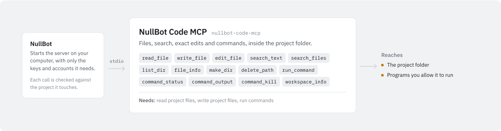

# NullBot Code MCP

<picture>
  <source media="(prefers-color-scheme: dark)" srcset="assets/nullbot-code-mcp-dark.svg">
  
</picture>

`nullbot-code-mcp` gives an agent coding tools for one workspace folder: list, read, write, and edit files, search by file name or content, and run commands in the background. It is a standalone Go MCP server built on [`github.com/Bradthebrad/tinychain/mcp`](https://github.com/Bradthebrad/tinychain). It works with NullBot and with any MCP client, and uses stdio by default.

## Tools

All paths are relative to the workspace folder.

| Tool | What it does |
| --- | --- |
| `workspace_info` | Shows the workspace folder, the path rule, and the read and command output limits. |
| `list_dir` | Lists a folder's entries with type, size, and modified time, folders first. `max_items` defaults to 200; values above 1000 fall back to 200. |
| `file_info` | Shows type, size, mode, and modified time for one file or folder. |
| `read_file` | Reads a text file, or only lines `start_line` to `end_line` (1-based, inclusive). Output stops at `max_bytes`, which cannot exceed `--max-read-bytes`. |
| `write_file` | Creates a text file and any missing parent folders. Fails if the file exists unless `overwrite` is true. `dry_run` reports what would be written. |
| `edit_file` | Replaces exact text. Fails unless the number of matches equals `expected_replacements` (default 1). `dry_run` previews the change. |
| `make_dir` | Creates a folder and its parents. |
| `delete_path` | Deletes a file or an empty folder. A folder with contents needs `recursive: true`. `dry_run` previews. |
| `search_files` | Finds files by glob pattern, such as `*.go`, `docs/*.md`, or `cmd/*/main.go`. `max_items` defaults to 200; values above 2000 fall back to 200. |
| `search_text` | Searches file contents for literal text, or a regular expression with `regex: true`. Supports `ignore_case` and a `file_pattern` filter. Returns path, line number, and line text. `max_matches` defaults to 100; values above 1000 fall back to 100. |
| `run_command` | Starts a command in the background and returns a `command_id`. Pass `command` and `args`, or set `shell: true` to run a shell snippet. `cwd` sets the working folder. |
| `command_status` | Reports whether a command is still running, and its exit code once it has finished. |
| `command_output` | Returns the kept stdout and stderr of a command, combined. `tail_bytes` returns only the newest bytes. |
| `command_kill` | Cancels a running command. |

Search details:

- `search_files` and `search_text` skip `.git`, `.hg`, `.svn`, `node_modules`, `.gocache`, `.gomodcache`, `dist`, and `vendor` folders.
- A pattern without a slash, such as `*.go`, is matched against each file's name and so finds files at any depth. A pattern with a slash is matched against the whole relative path. `**/` matches zero or one folder level, not any depth.
- `search_text` cuts matching lines to 500 bytes.

## Use it with NullBot

NullBot is a small, auditable Go agent ([Bradthebrad/nullbot](https://github.com/Bradthebrad/nullbot)) with a terminal UI and a headless CLI. Its main interface is the desktop app ([Bradthebrad/nullbot_ui](https://github.com/Bradthebrad/nullbot_ui)).

1. In the desktop app, open **Tools > Marketplace** and choose **Install** on NullBot Code MCP. Install always fetches the newest release (`v0.3.0` as of this writing) and checks it against the release's `SHA256SUMS.txt`; **Check for updates** refreshes the catalog's listing.
2. NullBot installs the server to `~/.nullbot/mcp/nullbot-code-mcp` and, when the release has a `SHA256SUMS.txt`, verifies the binary against it.
3. NullBot starts the server over stdio with `--workspace` set to the folder of your primary project.

NullBot checks every tool call against the permission of the project it touches: Read only, Read & write, Full, or Custom. Full is needed to run programs. Where projects overlap, the stricter one wins. A call that names no folder is judged by the primary project.

NullBot works out what each tool needs (read, write, delete, or run) from the server's hints and the tool's name. You can change it per tool on the Tools page. This server sends no hints, so the names decide. With NullBot's current rules:

- `run_command`, `command_status`, `command_output`, and `command_kill` need run, so they only work in a Full project. The last three count as run because their names contain "command".
- `delete_path` needs delete.
- `write_file`, `edit_file`, and `make_dir` need write.
- All other tools need read.

To build a server like this one, see the [mcp-skill](https://github.com/Bradthebrad/nullbot-skills/tree/main/skills/mcp-skill) package in Bradthebrad/nullbot-skills.

## Use it with another MCP client

Point the client at the binary and pass `--workspace`. The config format varies by client; a common shape is:

```json
{
  "mcpServers": {
    "code": {
      "command": "C:\\path\\to\\nullbot-code-mcp.exe",
      "args": ["--workspace", "C:\\path\\to\\project"]
    }
  }
}
```

Without `--workspace`, the server uses the folder it was started in.

## Configuration

### Flags

| Flag | Default | Meaning |
| --- | --- | --- |
| `--transport` | `stdio` | `stdio`, `streamable-http`, `http`, or `sse`. |
| `--addr` | `127.0.0.1:8765` | Listen address for the HTTP and SSE transports. |
| `--path` | `/mcp` | Streamable HTTP endpoint. |
| `--sse-path` | `/sse` | Legacy SSE endpoint. |
| `--message-path` | `/message` | Legacy SSE message endpoint. |
| `--workspace` | `.` | Workspace folder. File tools cannot leave it. |
| `--max-read-bytes` | `524288` | Most bytes `read_file` returns. |
| `--max-command-bytes` | `131072` | Most output bytes kept per command. |
| `--version` | `false` | Print the version and exit. |

### Environment variables

The server reads no environment variables. Commands started by `run_command` inherit the server's environment.

### Transports

Default stdio:

```powershell
.\nullbot-code-mcp.exe --workspace C:\path\to\project
```

Streamable HTTP (`http` is the same transport):

```powershell
.\nullbot-code-mcp.exe --transport streamable-http --addr 127.0.0.1:8765 --path /mcp --workspace C:\path\to\project
```

Legacy SSE:

```powershell
.\nullbot-code-mcp.exe --transport sse --addr 127.0.0.1:8765 --sse-path /sse --message-path /message --workspace C:\path\to\project
```

## Safety

File access:

- A path may be relative to the workspace or absolute, as long as it is inside the workspace; paths that leave it, with `..` or an absolute path elsewhere, are refused, and the error names the workspace so the agent can correct the path.
- Links are resolved: a file or folder link inside the workspace that points outside it is refused, for reads and writes.
- `write_file` does not replace an existing file unless `overwrite` is true.
- `delete_path` refuses to delete the workspace folder itself, and deletes folders with contents only when `recursive` is true.
- `write_file`, `edit_file`, and `delete_path` accept `dry_run` to preview a change.

Commands:

- Command execution is included on purpose, because this is a coding server. The working folder must be inside the workspace, but the command itself runs with the server's user rights and can reach anything that user can. Clients should ask the user before running risky commands.
- Commands run in the background and have no time limit. Use `command_kill` to stop one.
- Output is capped at `--max-command-bytes` per command. When a command prints more, the oldest bytes are dropped, so noisy commands do not flood the agent's context.
- `shell: true` runs the command through `cmd.exe /C` on Windows and `sh -c` elsewhere. Prefer `command` plus `args`.
- On Windows, a command with no `args` is sent through `cmd.exe /C` automatically when it starts with a `cmd` built-in (`dir`, `cd`, `copy`, `del`, `erase`, `md`, `mkdir`, `move`, `ren`, `rename`, `rd`, `rmdir`, `set`, `type`, `ver`, `vol`) or contains `|`, `&`, `<`, or `>`.

Network:

- The HTTP and SSE transports have no authentication. Keep `--addr` on `127.0.0.1`.

## Build and test

The module needs Go 1.26.4 (from `go.mod`) and depends on `github.com/Bradthebrad/tinychain` v0.2.0.

```powershell
go test ./...
go vet ./...
go build -trimpath -ldflags "-s -w" -o nullbot-code-mcp.exe ./cmd/nullbot-code-mcp
```

On Linux or macOS, drop the `.exe` from the output name. `nullbot-code-mcp --version` prints the version.

On 2026-10-27, `go vet ./...` and `go test ./...` passed with Go 1.26.4 on Linux.
